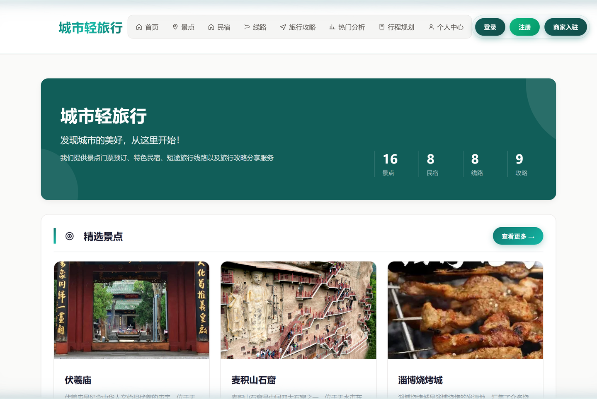
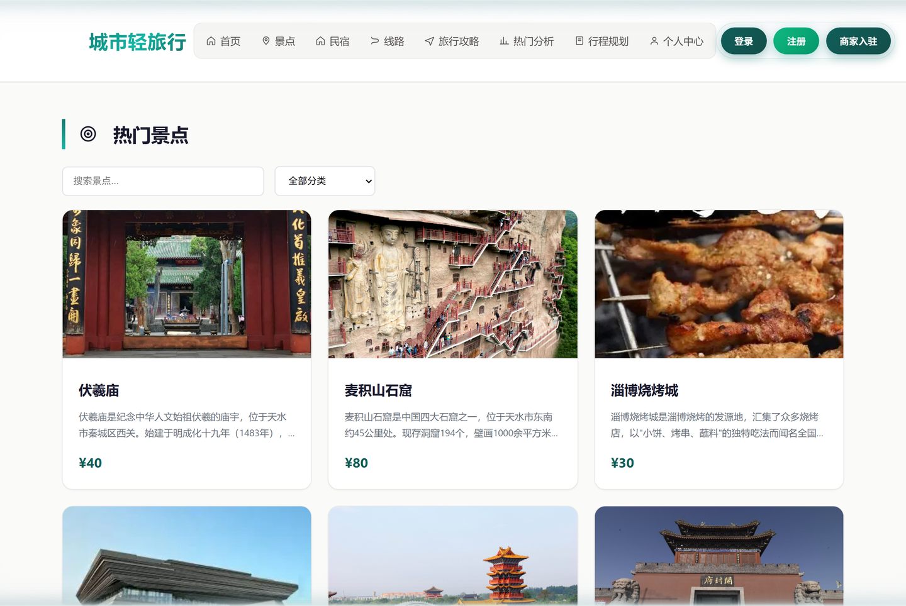
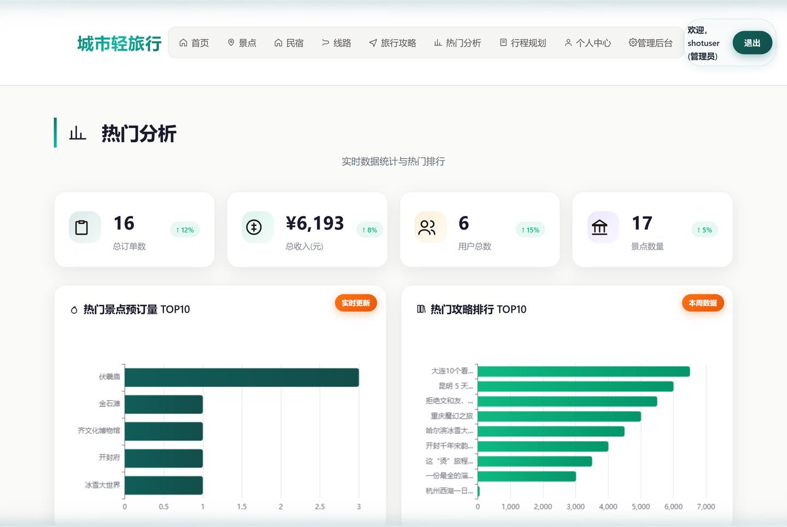
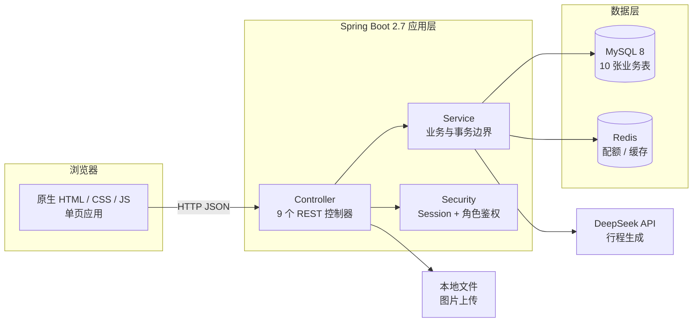

# 城市轻旅行攻略与预订小站

[](https://github.com/cck-10086/city-travel/actions/workflows/ci.yml)

面向城市短途旅行场景的全栈课程项目，覆盖景点、民宿、路线、攻略、订单、评论、收藏、审核与数据统计，并集成 DeepSeek 生成结构化行程。

## 界面预览

| 首页 | 景点列表 |
|---|---|
|  |  |



## 系统架构



## 技术栈

- Java 8、Spring Boot 2.7.18、Spring Security
- MyBatis-Plus、MySQL、Redis
- DeepSeek API、OkHttp、Jackson
- 原生 HTML/CSS/JavaScript、ECharts、百度地图 API

## 核心设计

- 使用 Session 维持登录态，并通过 Spring Security 映射管理员、已审核商家和游客角色。
- 公开查询仅返回审核通过内容；管理统计、内容审核和商家后台按角色拦截。
- 订单名称与金额由后端读取商品数据并重新计算，不信任前端传入价格。
- AI 行程支持天数、预算、目的地和偏好输入，返回结构化 JSON；提供本地规则模式作为基础能力。
- Redis 用于 AI 调用配额、结果缓存和成本统计，相同请求默认缓存 30 分钟。
- 密码、数据库凭据和 AI 密钥不写入响应或源码，均通过环境变量注入。
- 图片上传限制为 JPG、PNG、GIF、WebP，单文件最大 5MB，并存储在源码目录之外。

## 本地运行

前置条件：MySQL 8、Redis、JDK 8 或更高版本。

1. 执行根目录的 `schema.sql` 初始化数据库。
2. 配置环境变量：

```powershell
$env:DB_PASSWORD = "你的数据库密码"
$env:DEEPSEEK_API_KEY = "你的 DeepSeek API Key"
```

3. 启动服务：

```powershell
.\mvnw.cmd spring-boot:run
```

4. 浏览器访问 `http://localhost:8080`。

不配置 `DEEPSEEK_API_KEY` 时，本地规则行程仍可使用，AI 模式会返回未配置提示。

## 可选环境变量

| 变量 | 默认值 | 说明 |
|---|---|---|
| `DB_URL` | `jdbc:mysql://localhost:3306/city_travel...` | 数据库连接地址 |
| `DB_USERNAME` | `root` | 数据库用户名 |
| `DB_PASSWORD` | 空 | 数据库密码 |
| `REDIS_PORT` | `6379` | Redis 端口 |
| `DEEPSEEK_MODEL` | `deepseek-chat` | 模型名称 |
| `UPLOAD_DIR` | `${user.dir}/uploads` | 图片目录 |
| `APP_DEMO_DATA_ENABLED` | `false` | 是否创建本地演示数据 |
| `APP_DEMO_DATA_PASSWORD` | 空 | 演示账号密码，启用演示数据时至少 8 位 |

## 测试与构建

```powershell
.\mvnw.cmd test
.\mvnw.cmd package
```

当前 13 个测试类、29 个用例，全部通过。测试按「防哪个风险」组织：

| 风险 | 测试类 | 用例数 |
|---|---|---|
| 未登录用户越权访问管理接口 | `SecurityRulesTest`、`SessionAuthenticationFilterTest` | 4 |
| 订单金额被前端篡改 | `OrderControllerTest` | 2 |
| 并发下单导致超卖 | `OrderStockTest` | 4 |
| 登录密码被暴力破解 | `UserServiceLockTest` | 3 |
| 攻略正文存储型 XSS | `FrontendEscapingTest` | 3 |
| 分页参数被恶意放大 | `PageUtilTest` | 2 |
| 密码等敏感字段泄漏到响应 | `UserSerializationTest` | 1 |
| 未审核内容被公开查询命中 | `StrategyControllerTest` | 2 |
| AI 返回非 JSON 时页面崩溃 | `TripPlanControllerTest` | 4 |
| 上传非图片文件 | `UploadControllerTest` | 2 |
| Redis 未配置时启动失败 | `RedisConfigTest` | 1 |
| 用户查询基础逻辑 | `UserServiceTest` | 1 |

CI 配置见 `.github/workflows/ci.yml`，push 与 PR 时自动执行 `mvn test` 并归档 surefire 报告。

## 已知限制

- 单页前端集中在 `src/main/resources/static/index.html` 一个文件里，没有构建步骤；页面变大后维护成本上升，后续应拆分。
- AI 行程依赖外部 DeepSeek API，网络不通时自动退回本地规则模式，此时行程质量低于 AI 模式。
- 库存扣减用数据库行级条件更新保证原子性，但未做分布式锁；单库部署下可靠，多实例分库场景需另加方案。
- 登录失败限流把计数放在单机内存里，重启即清零；多实例部署时应迁移到 Redis。
- 百度地图需自行申请 AK 才能显示地图，未配置时降级为跳转百度地图搜索页。
## 说明

- `schema.sql` 当前定义 10 张业务表。
- 项目保留 Java 8 与 Spring Boot 2.7 基线，Maven 编译配置已兼容较新 JDK。
- 演示账号默认关闭，禁止在公开仓库提交真实数据库密码或 API Key。
- 前端地图接入百度地图，`src/main/resources/static/index.html` 中的 `YOUR_BAIDU_MAP_AK` 需替换为你自己的 AK 后地图才能正常显示。
